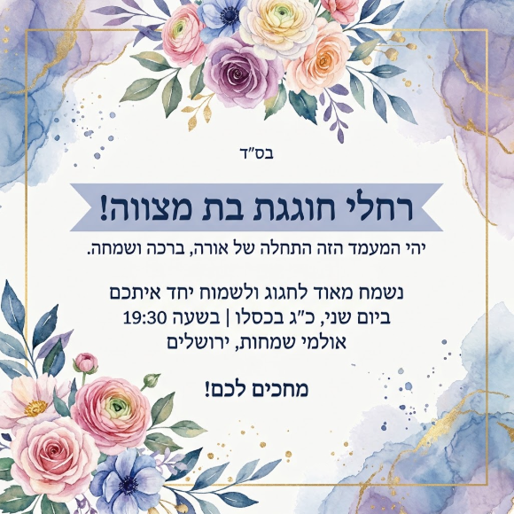
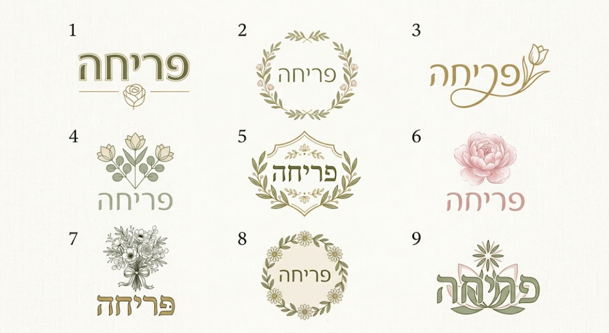
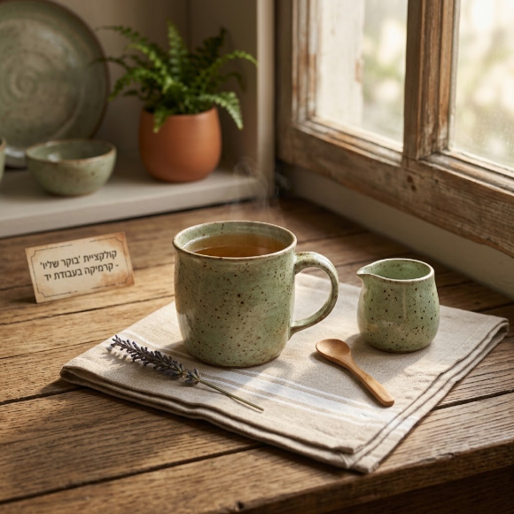
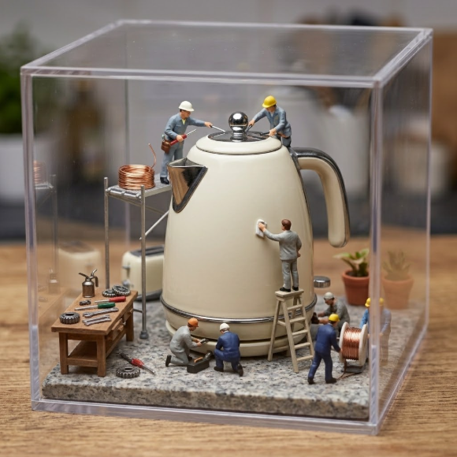

# מארז מתנה: חמישה סקילים לגרפיקאיות

מתנה מרות פריסמן ([Clearלי](https://aiclearlyapp.com)) לתלמידות קורס וידאו ותמונות בבינה מלאכותית.

חמישה סקילים מוכנים ל-Gemini, שעושים את העבודה היומיומית של מעצבת: הזמנות, לוגואים, צילומי מוצר, חפצים, והסקיל של המותג שלך. כולם נבדקו בפועל, והדוגמאות למטה יצאו מהם.

**כל סקיל קודם שואל, ורק אחר כך יוצר.** הוא שואל שאלה אחת בכל פעם, עם תשובות ממוספרות. אפשר לענות רק במספר. לפני שהוא יוצר הוא מסכם, ומבקש: "אם הכול נכון, כתבי 'צרי'".

## הסקילים

| סקיל | מה הוא עושה | מפעילים |
|---|---|---|
| **הזמנה לשמחה** · [`invitation`](invitation/SKILL.md) | כותב 3 נוסחים, ומעצב הזמנה להדפסה, לווטסאפ או לסטורי | `@invitation` |
| **סטודיו ללוגו** · [`logo-studio`](logo-studio/SKILL.md) | לוח של 9 אפשרויות, 4 וריאציות, הדמיה על שלט או כרטיס, ולוח מותג עם קודי צבע | `@logo-studio` |
| **צילומי מוצר** · [`product-shot`](product-shot/SKILL.md) | מצילום ביתי, תמונה מקצועית או סט לפוסט, סטורי ובאנר. המוצר נשאר זהה | `@product-shot` |
| **משחקים עם חפצים** · [`object-play`](object-play/SKILL.md) | פירוק לחלקים, מדבקה, אייקון, מיניאטורה, חומר אחר, חתך, שרטוט | `@object-play` |
| **סקיל המותג שלי** · [`my-brand-skill`](my-brand-skill/SKILL.md) | קורא את לוח המותג שלך, וכותב לך סקיל מותג מוכן להדבקה | `@my-brand-skill` |

## דוגמאות

**הזמנה לשמחה:** "הזמנה לבת מצווה של רחלי, כ״ג בכסלו, 19:30, אולמי שמחות, ירושלים. לווטסאפ, צבעי מים ופרחים." הסקיל כתב 3 נוסחים, בחרתי בקצר, וכתבתי "צרי".

**סטודיו ללוגו:** "לוגו לחנות פרחים בשם 'פריחה', לזרים לשמחות ולשבת. עדין, טבעי, יוקרתי."

**צילומי מוצר:** העליתי צילום ביתי של ספל, וכתבתי "תמונה לחנות של קרמיקה, באווירת בית חמים, ריבוע לפוסט."

**משחקים עם חפצים:** העליתי קומקום, וכתבתי "מיניאטורה".

**סקיל המותג שלי:** צירפתי לוח מותג של סטודיו לדוגמה, וקיבלתי סקיל מותג מוכן להדבקה. [ראו את מה שהוא כתב](examples/my-brand-skill-output.md).

## איך מתקינים ב-Gemini

1. מורידים את קובץ ה-ZIP של הסקיל מהתיקייה [`zips`](zips): לוחצים על הקובץ, ואז על כפתור ההורדה. או את כולם יחד: [`all-skills.zip`](all-skills.zip) (מחלצים אותו, ובפנים יש ZIP לכל סקיל).
2. ב-[gemini.google.com](https://gemini.google.com) מקלידים `@` בתיבת הכתיבה, ואז **סקילים** ← **לכל הסקילים**.
3. **יצירה** ← **העלאה** ← **קבצים**, ובוחרים את קובץ ה-ZIP של הסקיל, כמו שהוא.
4. נפתח עורך עם הסקיל. לוחצים **יצירה** (למעלה), כדי לשמור.
5. בשיחה חדשה: `@` ושם הסקיל, ואז הבקשה.

**מה צריך:** חשבון גוגל אישי (לא של בית ספר או עבודה), ו"פעילות באפליקציות Gemini" מופעלת.

**סקיל שהוחלף עובר ל"לא פעיל".** אם מעלים גרסה חדשה דרך "החלפת סקיל", הוא עובר ל"לא פעיל". שלוש הנקודות ליד הסקיל ← **הפעלה**.

## מה למדנו בבדיקות

- **בודקות כל אות.** הטקסט העברי יוצא לרוב נכון, אבל לפעמים נכנס לתמונה סימן מהנוסח (כמו כוכביות), או כיתוב קטן באנגלית בפינה.
- **בוחרות במילים, לא רק במספר.** "בחרתי ב-4, הלחם בתוך האות". מספר לבד מתבלבל בסבב הבא.
- **מצרפות את לוח המותג** לכל בקשה במותג שלך. כך הלוגו יוצא מדויק.
- **סקיל לא עשה מה שביקשתן?** כותבות לו "זה לא לפי הסקיל", ומה רציתן. ואם זה חוזר, שלוש הנקודות ← **עריכה ידנית**, ומוסיפות כלל.

## משלכן, ל-Claude

אותם קבצים בדיוק (`SKILL.md`) עובדים גם ב-Claude Code. בשיעור הבא נתקין אותם שם.
