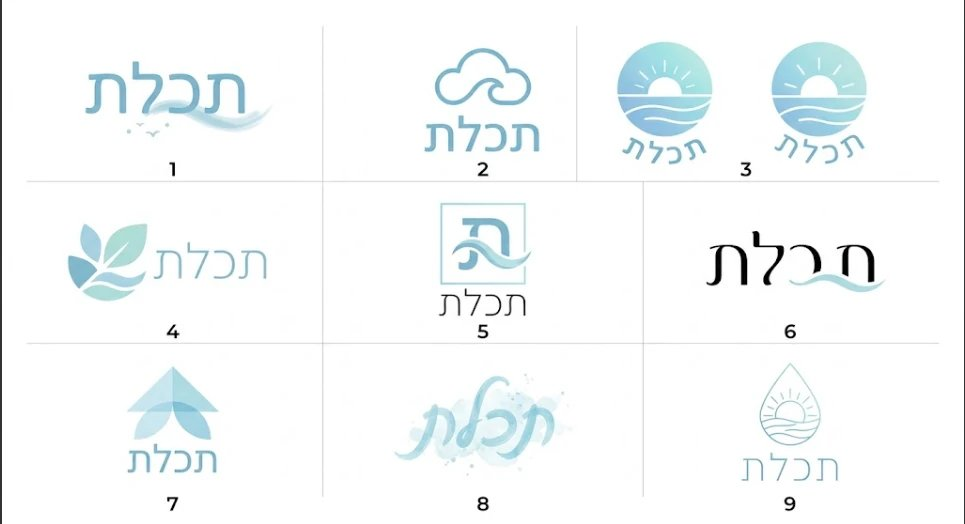
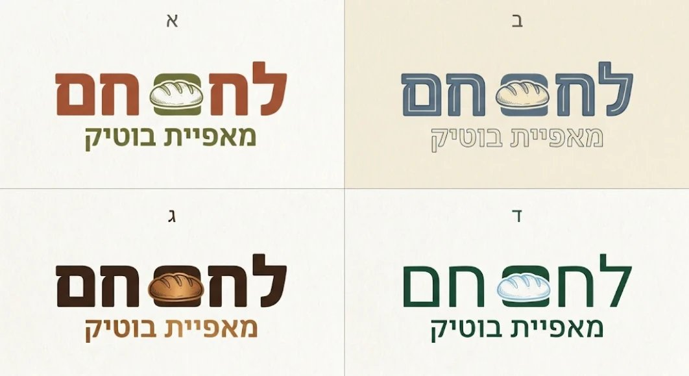
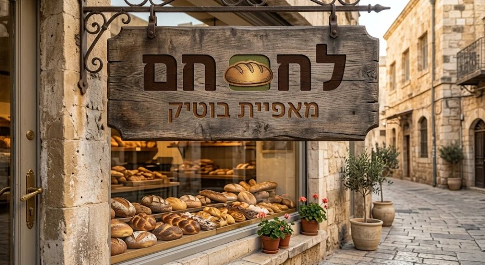
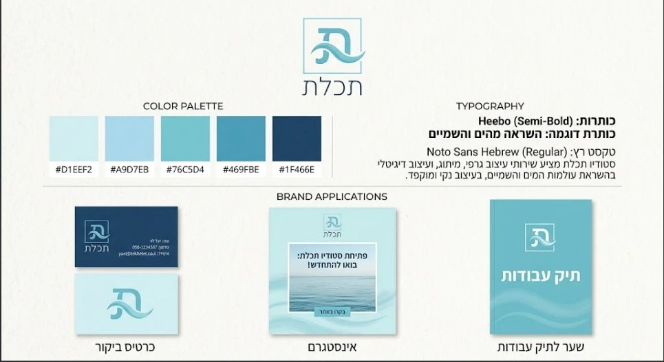
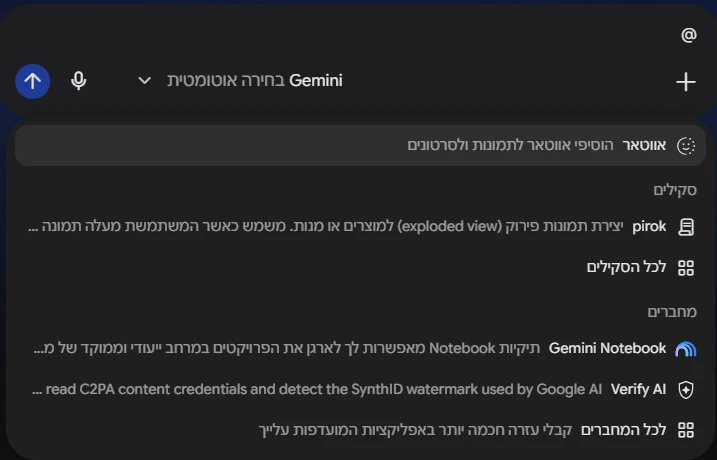
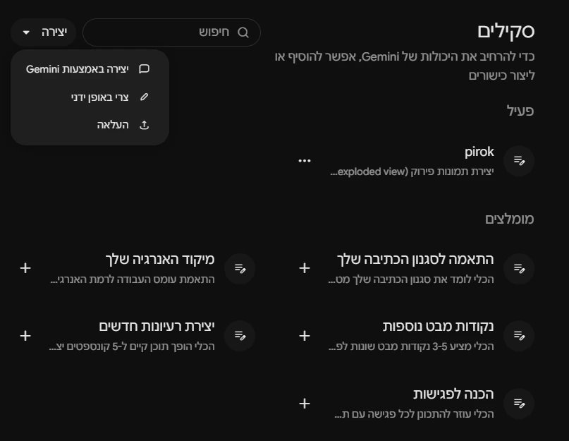
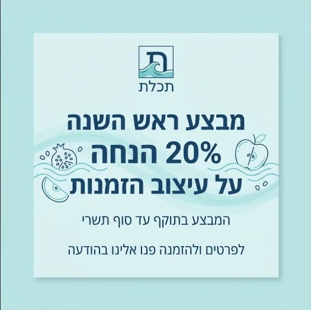
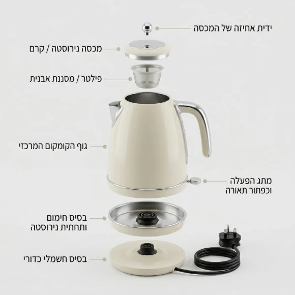
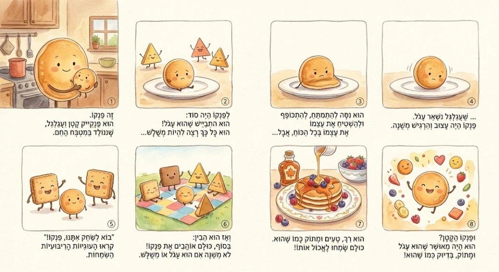
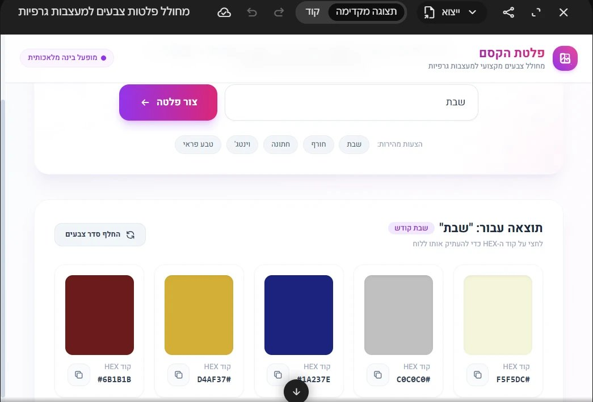

# שיעור מבוא: הסטודיו שבדפדפן · סיכום

קורס וידאו ותמונות בבינה מלאכותית · רות פריסמן, [Clearלי](https://aiclearlyapp.com) · יום ראשון, ז׳ בחשוון תשפ״ז (18.10.2026)

כאן כל החומר של השיעור, צעד אחרי צעד, עם הנוסחים שאפשר להעתיק. ובסוף: **מתנה, מארז של חמישה סקילים.**

---

## הפרויקט של הקורס: הסטודיו שלי

כל אחת בונה מותג לסטודיו שלה, כמעצבת. בכל שיעור נוסף לו חלק, ובשיעור האחרון מציגות.

| שיעור | מה נבנה |
|---|---|
| 1. מבוא | לוגו, לוח מותג, סקיל מותג ב-Gemini, ושלושה פריטים ראשונים |
| 2. Claude Code | אותו סקיל עובר ל-Claude, ובונה קבצים: מסמך מותג ותבניות |
| 3. מושן | לוגו מונפש, ופרומו קצר לסטודיו |
| 4. עריכה | סרטון תדמית מהעבודות שלכן, עם ג'ינגל |
| 5. הצגה | ערכת השקה מלאה, מול הכיתה |

**הכול נשמר בתיקייה אחת: "הסטודיו שלי".**

## ארבעה כללים שמלווים את כל העבודה

1. **פרומפט = בריף:** מה רואים, איפה, איך מצלמים, איזה אור, סגנון וצבעים, לאן ומה לא.
2. **עריכה במילים:** "תשאיר הכול בדיוק אותו דבר, ותשנה רק את..."
3. **מה שלא כותבים, הוא בוחר:** זווית, צבעים, ואפילו כיתוב באנגלית שאף אחד לא ביקש.
4. **בודקות הכול:** אות אחרי אות, פינה אחרי פינה, מקור אחרי מקור.

---

## 1. מחקר לפני מיתוג: Deep Research

ב-Gemini: **כלים** ← **Deep Research**, וכותבות:

> מה עובד היום במיתוג של סטודיו לעיצוב גרפי בישראל, לקהל של [למי אני מעצבת]? צבעים, טיפוגרפיה עברית, ואיך מעצבות מציגות את עצמן.

הוא מציג תוכנית. לוחצות **התחלת המחקר**, וממשיכות לעבוד. אחרי כמה דקות מחכה דוח ארוך בעברית, עם עשרות מקורות. גם כאן בודקות: פותחות שניים-שלושה מקורות.

## 2. הלוגו: מנהלת אמנותית מבקשת אפשרויות

**סבב 1: לוח של תשע**

> אני מעצבת גרפית שפותחת סטודיו בשם __. הסגנון שלי: __. צרי לוח אחד עם 9 אפשרויות ללוגו, ממוספרות 1 עד 9. בלי אנגלית.

**ובודקות:** בדוגמה הזו, ב-6 כתוב "חכלת" במקום "תכלת", וב-3 יש שני לוגואים.

**סבב 2, והרחבה**

> אהבתי את __ (ומתארות במילים, למשל: "הטיפה עם השמש"). תני 4 וריאציות על הכיוון הזה בלבד, ממוספרות א עד ד.

> בוחרת ב-__. תראי את הלוגו הזה בדיוק, על כרטיס ביקור / שלט / שקית.

 

**בוחרות במילים, לא רק במספר.** כשכתבתי רק "לוגו 9", בסבב הבא הוא לקח לוגו אחר.

## 3. לוח מותג: מערכת שלמה בתמונה אחת

> צרי תמונה: לוח מותג לסטודיו __, עם הלוגו [תיאור]. לוגו, פלטה של 5 צבעים עם קודי HEX, גופן לכותרת ולטקסט, ושלושה שימושים: כרטיס ביקור, פוסט ושער לתיק עבודות. כל הכיתובים בעברית.

- הגופנים שהוא בוחר אמיתיים (כמו Heebo ו-Noto Sans Hebrew), וקודי הצבע אמיתיים. **מעתיקות אותם לדף**, ושומרות את הלוח כקובץ.
- ענה "אני רק מודל שפה"? כותבות שוב, ומתחילות ב"צרי תמונה:".

## 4. "קודים" של ChatGPT, וסקילים של Gemini

**הקודים שמסתובבים ברשת** (`/explode`, `/layers`, `/sticker`) הם לא פקודות אמיתיות. הם מילים שהבינה מבינה, כמו כל מילה אחרת. מה שכן קיים באמת ב-ChatGPT: לחיצה על תמונה פותחת סרגל עם סימון, הסרת רקע, מחיקה ושינוי גודל.

**סקיל הוא פקודה שלך.** כמו Action של פוטושופ, רק במילים: כותבים פעם אחת איך עושים, ומפעילים מתי שרוצים. בסקיל יש שלושה חלקים:

- **שם:** באנגלית, באותיות קטנות. אותו מקלידים אחרי `@`.
- **תיאור:** לפיו Gemini מחליט מתי להפעיל את הסקיל, גם לבד.
- **הוראות:** מה עושים, באיזה סדר, ומה אסור.

**איפה זה ב-Gemini:** מקלידות `@` בתיבת הכתיבה ← **סקילים** ← **לכל הסקילים** ← **יצירה**. יש שלוש דרכים: באמצעות Gemini (בשיחה), ידנית, או העלאה של קובץ.

 

## 5. סקיל המותג שלי

**יצירה** ← **יצירה באמצעות Gemini**, ומדביקות את החומרים מלוח המותג:

> אני רוצה סקיל מותג בשם __: כל פוסט, סטורי, כרטיס או הזמנה ייצאו במותג שלי. הלוגו: [תיאור במילים]. צבעים: [קודי HEX]. גופנים: [כותרת וטקסט]. הסגנון: [שלוש מילים]. כללים: כל הטקסט בעברית, גם בפינות; מעט מילים. קודם שואל מה חסר, שאלה אחת בכל פעם.

- **הוא התחיל לעבוד במקום לשמור?** "עוד לא יוצרים. תשמרי כסקיל".
- **נתקע ב"שומר את הסקיל..."?** "תשמור אותו עכשיו".
- **מוודאות שנשמר:** מופיע כרטיס עם שם הסקיל.

**בודקות אותו:** שיחה חדשה, **מצרפות את לוח המותג** (כך הלוגו יוצא מדויק), `@` ושם הסקיל, ומבקשות שלושה פריטים: כרטיס ביקור, פוסט "הסטודיו פתוח" ושער לתיק עבודות. שמות אותם זה ליד זה: נראים כמו מותג אחד?

 

בפינה של הסטורי נוסף כיתוב קטן באנגלית, למרות הכלל. **בודקות כל פינה,** ומוסיפות כלל לסקיל: שלוש הנקודות ליד הסקיל ← **עריכה ידנית**.

**סקיל ראשון כמעט אף פעם לא מושלם.** בונים, בודקים, מתקנים. ומה שעבד בבדיקות שלי: קודם הסקיל כותב מה הבין ושואל "לתקן משהו? אם הכול נכון, כתבי 'צרי'", ורק אחרי "צרי" הוא יוצר תמונה.

## 6. מתמונה לסרט

**סטוריבורד בתמונה אחת:**

> [מצרפות את לוח המותג] צרי סטוריבורד של 6 פריימים לסרטון תדמית של 8 שניות לסטודיו שלי. בצבעי המותג, וכיתוב קצר בעברית מתחת לכל פריים.

**ג'ינגל:** **כלים** ← **יצירת מוזיקה**. ג'ינגל של 30 שניות עם שם הסטודיו. בוחרות אורך, קול וסגנון, ומורידות כ-MP3. המילים בעברית מושרות בדיוק.

**וידאו (הדגמה):** ב-[Flow](https://flow.google.com) מעלים תמונה, ⋮ ← **אנימציה**, וכותבים מה זז. 8 שניות, 10 קרדיטים מתוך 50 ביום. בודקות כל פריים: בדוגמה שלי נוסף כיתוב באנגלית.

**כלי ב-Canvas:** **כלים** ← **Canvas**, ומתארות כלי לסטודיו בצבעי המותג. למשל: דף נחיתה, שאלון בריף ללקוחה, מחירון מעוצב, או מחולל פלטות.

---

## עד השיעור הבא: ממשיכות את הפרויקט

1. לוגו סופי ולוח מותג, שמורים כקבצים.
2. סקיל המותג, בדוק ומתוקן, ושלושה פריטים שיצאו ממנו.
3. חמש עבודות שלכן (תמונות או סרטונים), לסרטון התדמית.
4. בונוס: הסטוריבורד והג'ינגל.

הכול בתיקייה "הסטודיו שלי".

## 🎁 מתנה: מארז של חמישה סקילים

חמישה סקילים מוכנים ל-Gemini, לעבודה היומיומית של מעצבת: **הזמנות, לוגואים, צילומי מוצר, חפצים, וסקיל המותג שלך.** כולם נבדקו, ויש דוגמאות.

**[לדף המארז: מה כל סקיל עושה, דוגמאות, והוראות התקנה](../gift-pack/README.md)**

**[להורדת כל הסקילים בקובץ אחד (all-skills.zip)](../gift-pack/all-skills.zip)**

## בשיעור הבא: Claude Code

אותו סקיל מותג, ב-Claude. הוא עובד על התיקייה "הסטודיו שלי" ובונה קבצים: מסמך מותג, תבניות, ובהמשך לוגו מונפש וסרטון תדמית.

---

**אחריות:** בודקות כל תמונה, מילה ומקור · לא מציגות תמונה שנוצרה כצילום אמיתי · השראה, לא העתקה · לא מעלות צילומים פרטיים של אנשים בלי רשות.

*כמה שתשקיעי, עם ס״ד, כך תגיעי.*
